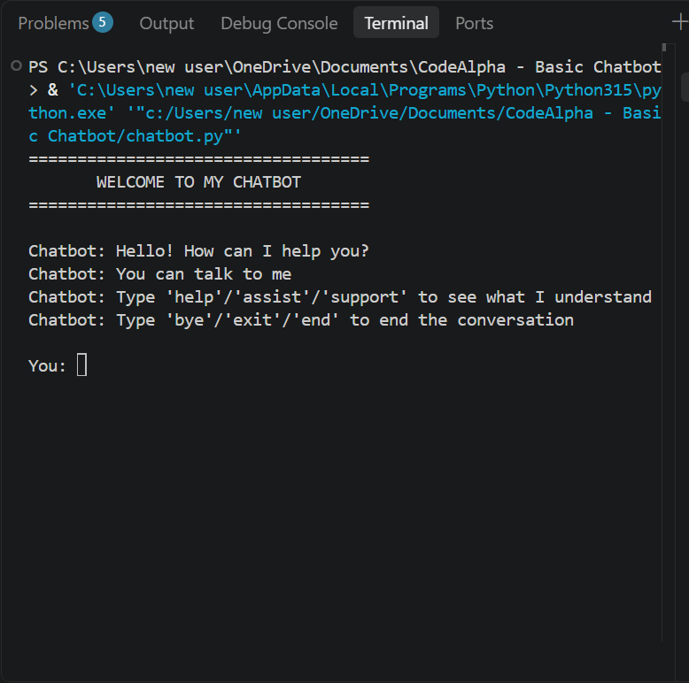
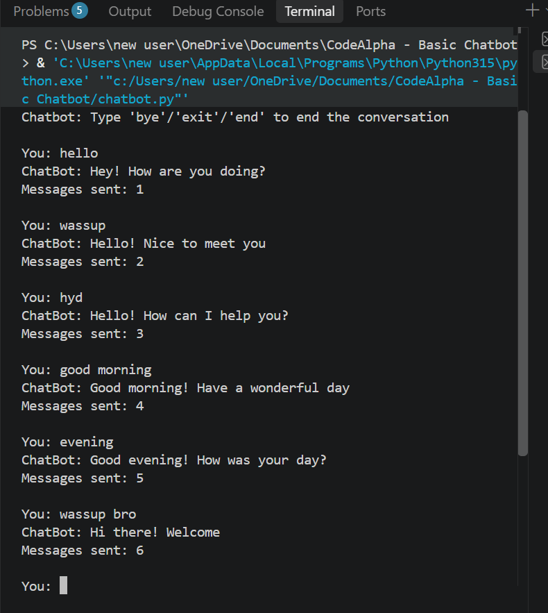
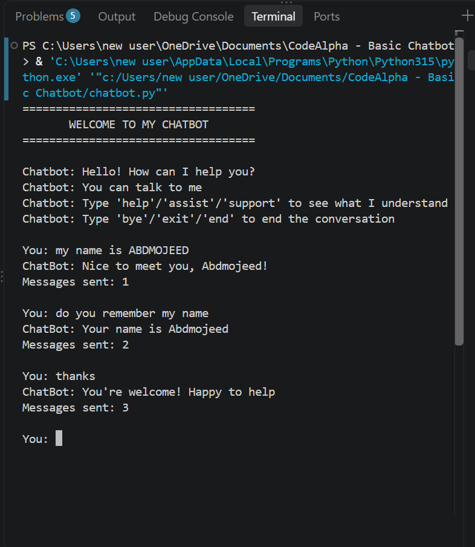
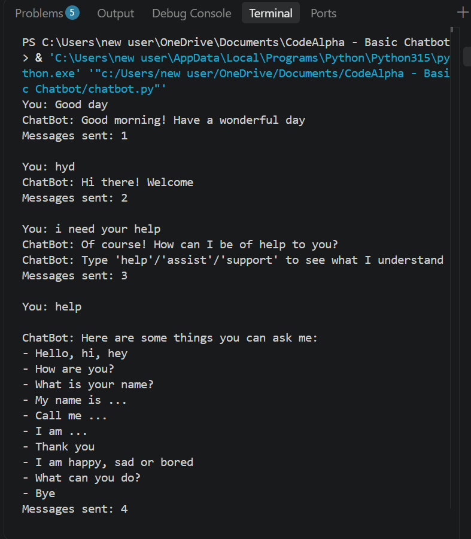
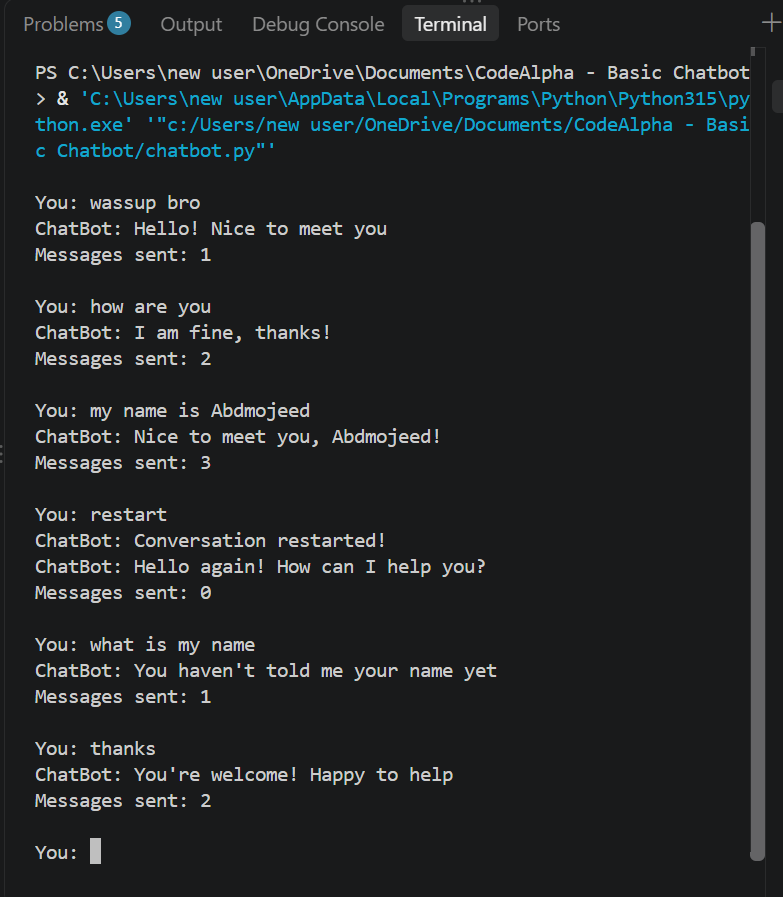

# Basic Chatbot 🤖

A simple rule-based chatbot built with Python as part of my **CodeAlpha Python Programming Internship**.

The chatbot interacts with users through predefined responses, recognises common messages, remembers the user's name during a conversation, and provides basic conversational assistance through a command-line interface.

## Features

- **Interactive Conversation:** Communicates with users through a continuous conversation loop.
- **Multiple Greetings:** Recognises different greetings and responds accordingly.
- **Random Responses:** Generates varied responses using Python's random module.
- **Name Recognition:** Recognises and remembers the user's name during a session.
- **Personalised Responses:** Uses stored user information to provide personalised replies.
- **Help Command:** Displays a list of supported messages and commands.
- **Restart Functionality:** Allows users to restart the conversation.
- **Exit Commands:** Supports multiple commands for ending the conversation.
- **Input Validation:** Handles empty inputs and basic invalid name entries.
- **Message Counter:** Tracks the number of messages sent during a conversation.
- **Unknown Input Handling:** Provides a default response when an unrecognised message is received.

## Technologies Used

- **Python 3**
- **Random Module** (Python Standard Library)

## Project Structure

```text
CodeAlpha - Basic Chatbot/
│
├── chatbot.py
├── README.md
│
└── images/
    ├── welcome.png
    ├── conversation.png
    ├── name-recognition.png
    ├── help-command.png
    └── restart.png
```

## Getting Started

### Prerequisites

- Python 3 installed on your computer.
- A code editor or terminal.


### Installation

1. Clone the repository:

```bash
git clone https://github.com/raffydex/codealpha_tasks.git
```

2. Navigate to the Hangman directory:

```bash
cd "codealpha_tasks/CodeAlpha - Hangman game"
```

3. Run the game:

```bash
python hangman.py
```


## How to Use

1. Run the Python file to launch the chatbot.
2. Enter a message when prompted.
3. Use recognised greetings and predefined messages to interact with the chatbot.
4. Type `help` to view supported messages and commands.
5. Introduce yourself using `my name is [your name]` or `call me [your name]`.
6. Type `restart` to restart the conversation.
7. Type `bye`, `exit`, or `end` to terminate the conversation.

## Screenshots

### 1. Welcome Screen



### 2. General Conversation



### 3. Name Recognition and Personalised Responses



### 4. Help Command



### 5. Restart Functionality



## Project Limitations

This project is a basic rule-based chatbot. It uses predefined messages and conditional statements to recognise and respond to user inputs.

It does not currently implement artificial intelligence, machine learning, natural language processing, external APIs, or persistent conversation storage.

## Learning Outcomes

Through this project, I practised and strengthened my understanding of:

- Python functions
- Conditional statements (`if`, `elif`, `else`)
- Loops (`while`)
- Lists
- String manipulation
- User input and output
- Input validation
- Random response generation
- Basic program organisation

## Author

**ABDRAFIU ABDMOJEED AYOYINKA**

Python Programming Intern — CodeAlpha

---

*Built as part of the CodeAlpha Python Programming Internship*