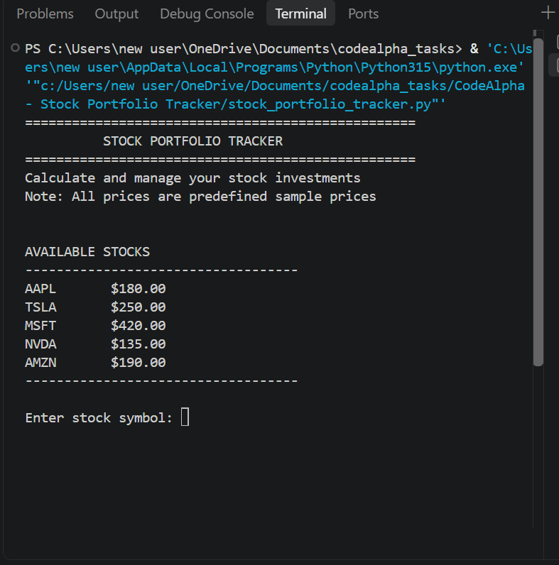
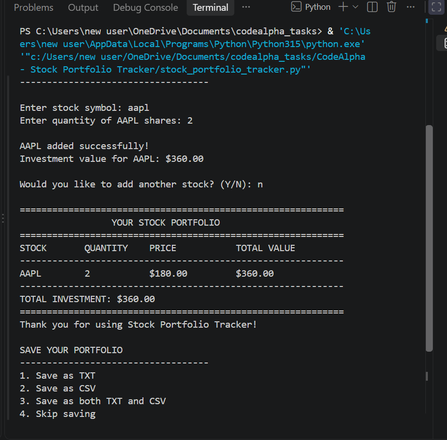
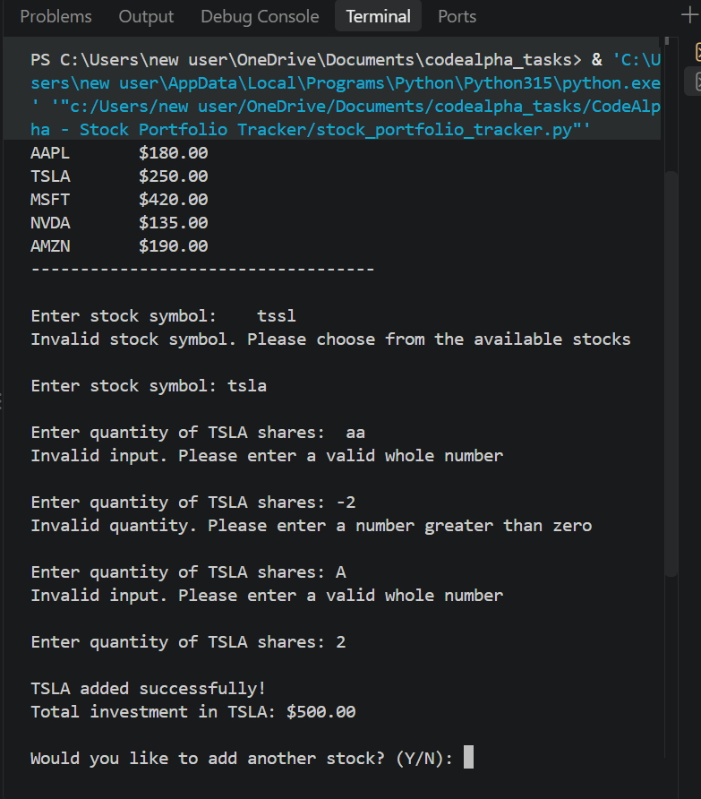
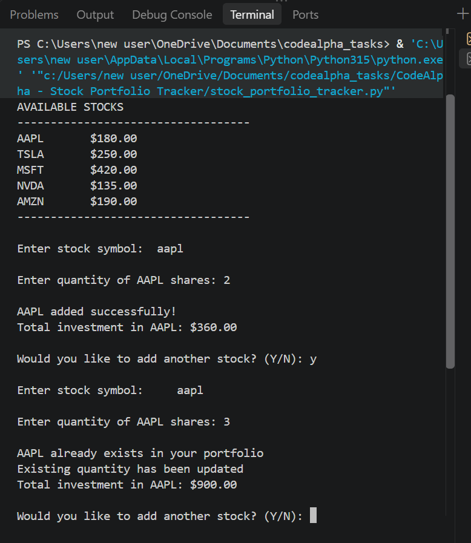
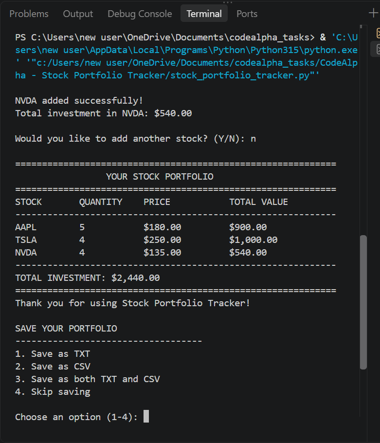
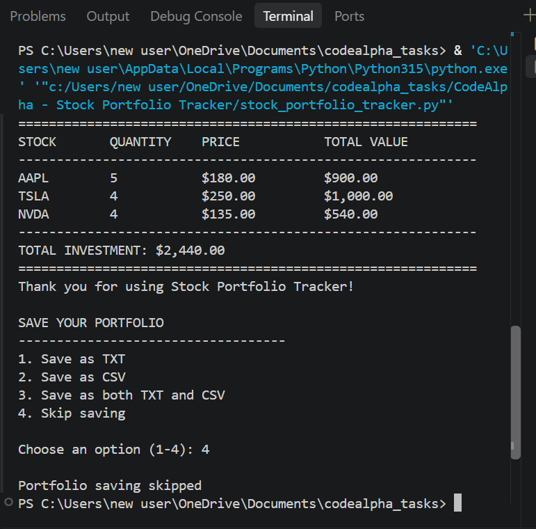
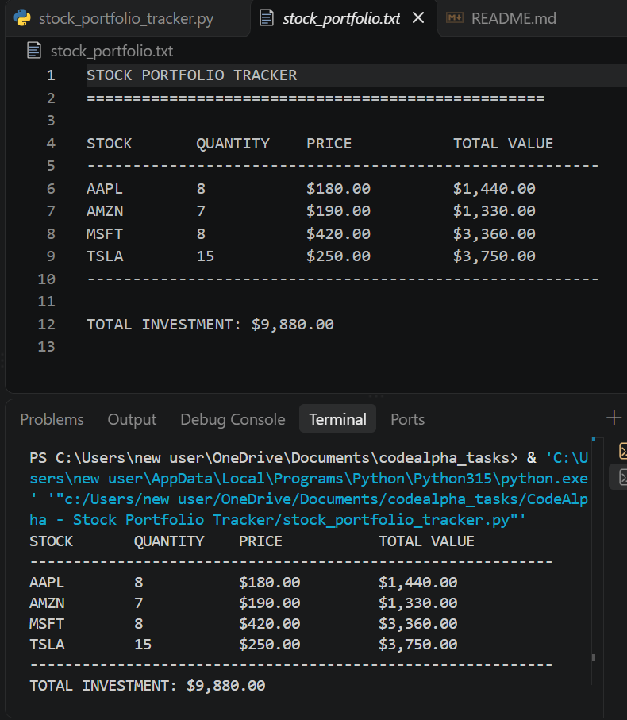
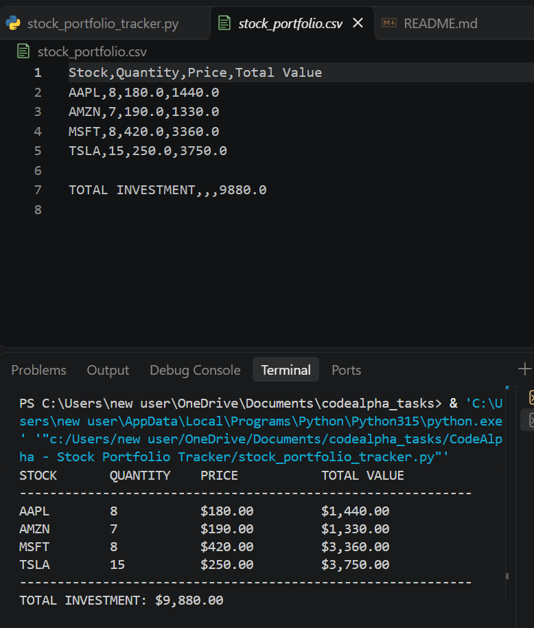

# Stock Portfolio Tracker 📊

A beginner-friendly Python application developed as part of the **CodeAlpha Python Programming Internship**.

The Stock Portfolio Tracker allows users to select predefined stocks, enter share quantities, calculate individual investment values, manage their portfolio and save their investment records in TXT or CSV format.

> **Note:** This application uses predefined sample stock prices and does not retrieve live stock market data.

## 📌 Project Overview

The Stock Portfolio Tracker is a terminal-based Python application designed to demonstrate fundamental Python programming concepts through a practical investment-tracking project.

Users can select from a list of available stocks, enter the number of shares they wish to track, calculate their investment values and view their complete portfolio.

The application also supports exporting portfolio records into text and CSV files for future reference.

## ✨ Features

- **Predefined Stock Prices:** Uses a Python dictionary to store available stock symbols and their sample prices.
- **Stock Selection:** Allows users to select stocks using their symbols.
- **Input Validation:** Checks stock symbols and ensures share quantities are valid positive whole numbers.
- **Investment Calculation:** Calculates the value of individual stock investments.
- **Portfolio Management:** Stores selected stocks and their quantities in a portfolio.
- **Duplicate Stock Handling:** Updates the quantity of an existing stock instead of creating duplicate entries.
- **Total Portfolio Calculation:** Calculates and displays the combined value of all selected investments.
- **TXT Export:** Saves portfolio information in a readable text file.
- **CSV Export:** Saves portfolio information in CSV format, which can be opened using spreadsheet applications such as Microsoft Excel.
- **Flexible Saving Options:** Allows users to save as TXT, CSV, both formats or skip saving.

## 🛠️ Technologies Used

| Technology | Purpose |
|---|---|
| Python | Main programming language |
| CSV Module | Exporting portfolio data into CSV format |
| Dictionaries | Storing predefined stock prices |
| Lists | Managing portfolio entries |
| Functions | Organizing application operations |
| File Handling | Saving portfolio records |

## 📂 Project Structure

```text
CodeAlpha - Stock Portfolio Tracker/
│
├── stock_portfolio_tracker.py
│
├── README.md
│
└── screenshots/
    ├── welcome.png
    ├── stock-selection.png
    ├── input-validation.png
    ├── duplicate-stock-update.png
    ├── final-portfolio.png
    ├── save-options.png
    ├── txt-export.png
    └── csv-export.png
```

## 🚀 Getting Started

### Requirements

- Python 3 installed on your computer.
- A code editor or terminal.
- Basic knowledge of running Python scripts.

No external Python libraries are required.

### Project Structure

```text
CodeAlpha - Stock Portfolio Tracker/
│
├── stock_portfolio_tracker.py
├── README.md
│
└── screenshots/
    ├── welcome.png
    ├── stock-selection.png
    ├── input-validation.png
    ├── duplicate-stock-update.png
    ├── final-portfolio.png
    ├── save-options.png
    ├── txt-export.png
    └── csv-export.png
```

## 💻 How to Use

1. Run the Python application.
2. View the welcome message and available stocks.
3. Enter a stock symbol from the displayed list.
4. Enter the number of shares you want to add.
5. The application calculates the investment value.
6. Choose whether to add another stock.
7. Once finished, view your complete stock portfolio.
8. Choose how you want to save your portfolio:
   - Option 1: Save as TXT.
   - Option 2: Save as CSV.
   - Option 3: Save as both TXT and CSV.
   - Option 4: Skip saving.

## 📸 Screenshots

### 1. Application Welcome Screen

Displays the application title, welcome message and available stocks with their predefined prices.



### 2. Stock Selection

Demonstrates how users enter stock symbols and specify the number of shares they want to add to their portfolio.



### 3. Input Validation

Shows how the application handles invalid stock symbols, incorrect quantity inputs and non-positive quantities.



### 4. Duplicate Stock Handling

Demonstrates how the application identifies an existing stock and updates its quantity instead of creating another entry.



### 5. Final Stock Portfolio

Displays the completed portfolio, including stock symbols, quantities, predefined prices, individual investment values and total investment.



### 6. Portfolio Saving Options

Shows the available options for exporting portfolio records as TXT, CSV, both formats or skipping the saving process.



### 7. TXT Export

Demonstrates the saved portfolio information in a readable text file.



### 8. CSV Export

Demonstrates the exported portfolio information in CSV format, which can be opened in spreadsheet applications.



## 🧮 Sample Stock Prices

The application uses the following predefined sample stock prices:

| Stock Symbol | Sample Price |
|---|---:|
| AAPL | $180.00 |
| TSLA | $250.00 |
| MSFT | $420.00 |
| NVDA | $135.00 |
| AMZN | $190.00 |

**Disclaimer:** These prices are for demonstration purposes only and do not represent current market prices.

## 🧠 Python Concepts Demonstrated

This project demonstrates the practical application of the following Python concepts:

- Variables and data types.
- Dictionaries and lists.
- Functions and function parameters.
- Conditional statements (`if`, `elif`, `else`).
- Loops (`for` and `while`).
- User input and output.
- Exception handling (`try` and `except`).
- String formatting.
- File handling.
- CSV file operations.
- Return statements.
- Main execution guard (`if __name__ == "__main__":`).

## 🔮 Possible Future Improvements

The following features could be considered in future versions:

- Integration with live stock market APIs.
- Ability to remove stocks from the portfolio.
- Ability to reduce or edit existing stock quantities.
- Portfolio data persistence between application sessions.
- More advanced portfolio analysis and reporting.

These improvements are outside the scope of the current beginner-level implementation.

## 🎓 Internship Information

**Internship:** CodeAlpha Python Programming Internship

**Project:** Stock Portfolio Tracker

**Programming Language:** Python

**Developer:** RAFFYDEX

This project was developed as part of my practical learning experience during the CodeAlpha Python Programming Internship.

## 👨‍💻 Author

**ABDRAFIU ABDMOJEED AYOYINKA**

GitHub: [@raffydex](https://github.com/raffydex)

---

⭐ If you find this project useful, feel free to explore the repository and provide feedback

**Built with Python and a commitment to continuous learning**